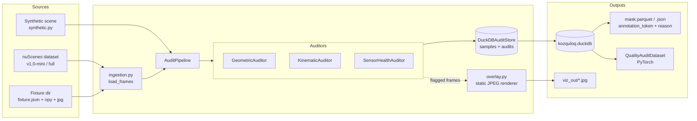
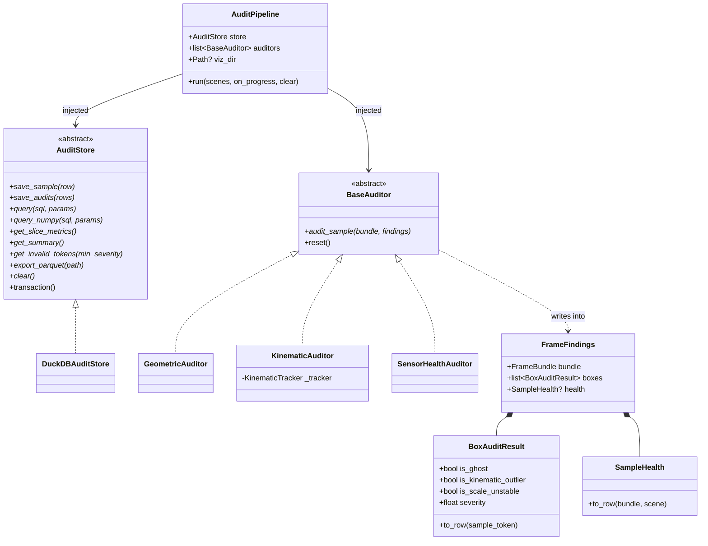
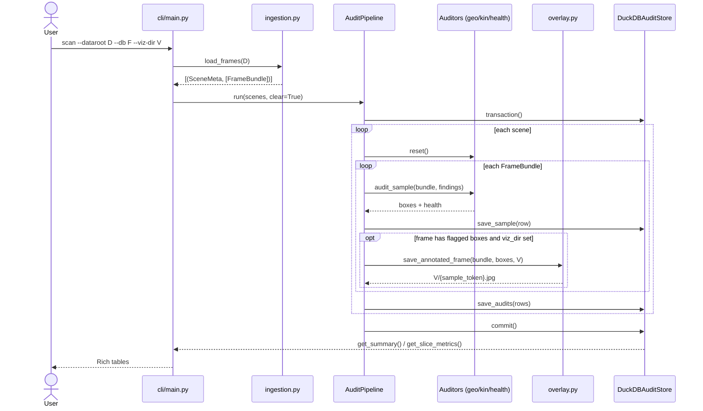
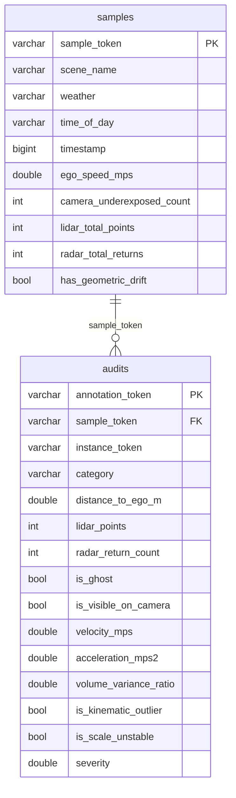

# Architecture

Kozquloq has one job: read nuScenes sensor logs, check every 3D annotation
against what the sensors actually saw, and produce two outputs - a mask of
invalid annotation tokens, and overlay images showing the flags visually.
Everything in the design exists to serve that pipeline.

## The data contracts

Three frozen dataclasses in `src/kozquloq/types.py` carry everything between
stages. They are immutable on purpose - an auditor must never mutate the
frame it is auditing, only append findings.

- `SceneMeta` - the scene: token, name, weather, time of day.
- `FrameBundle` - one synchronized keyframe: the camera image, the LiDAR
  cloud, the annotation boxes, and the four SE(3) transforms plus intrinsics
  needed to go `lidar -> ego -> global -> ego -> camera`. The detour through
  the ego frames is not ceremony: the sensors fire at different timestamps
  and the car moved in between.
- `AnnBox` - one annotation in the global frame. nuScenes convention: local
  x is length, y is width, z is height. Getting this wrong silently corrupts
  point counts and manufactures ghosts.

## Component overview

## Class diagram

The two seams that matter are `BaseAuditor` and `AuditStore`. Both are
dependency-injected into `AuditPipeline`, so you can swap the store or add an
auditor without touching pipeline code.

Auditor order is load-bearing. `GeometricAuditor` fills `findings.boxes`,
`KinematicAuditor` refines those results in place (velocity and acceleration
are computed per instance across frames, so it keeps a tracker and resets it
per scene), and `SensorHealthAuditor` reads the box results for its drift
check. The kinematic state is also why `viz` runs the auditors over the
whole scene instead of just the target frame - a teleport only shows up if
the tracker saw the frames before it.

## Sequence: `kozquloq scan`

The whole audit runs inside one transaction. A killed scan rolls back instead
of leaving a half-written database that still computes a healthy grade -
a partial dataset would otherwise look better than it is.

## Storage schema

Two tables is the whole database. `samples` is per-keyframe context;
`audits` is one row per annotation with the flags and the severity.

Two views sit on top for the summary tables:
`view_slice_failure_rates` (failure % grouped by weather, time of day, and
category) and `view_severe_outliers` (`severity >= 0.5` joined with scene
context). All queries are parameterized - there is no dynamic SQL surface.

## The rules it enforces

- **Ghost label** - the box claims a `vehicle.*` or `human.pedestrian.*`
  category, sits within 35 m of the ego, and contains zero LiDAR returns
  after the ground plane is removed (anything below lidar z = -2.0 m is road
  surface, not object evidence). Ghosts score 0.55 and land in the mask.
- **Kinematic outlier** - acceleration between consecutive keyframes of one
  `instance_token` exceeds the class cap: 8 m/s² for pedestrians, 12 for
  vehicles. That is a tracking hop or a jittered center, not physics.
  Severity 0.25, so it downweights rather than masks by default.
- **Scale unstable** - a rigid object whose volume changed more than 15%
  between frames. Severity 0.20.
- **Underexposed frame** - mean camera intensity below 25/255.
- **Geometric drift** - a camera-visible box with plenty of 3D LiDAR hits
  shows almost no projected returns inside its 2D footprint, meaning the
  extrinsics went stale.

A flagged annotation can stack severities - a box that is both a ghost and a
kinematic outlier scores 0.80 and clearly belongs out of the training set.
