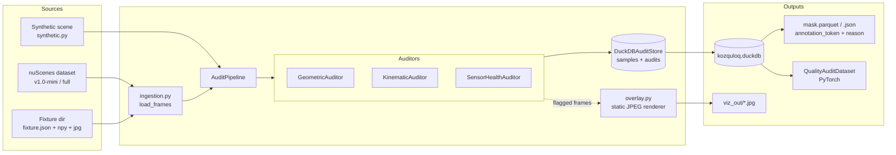
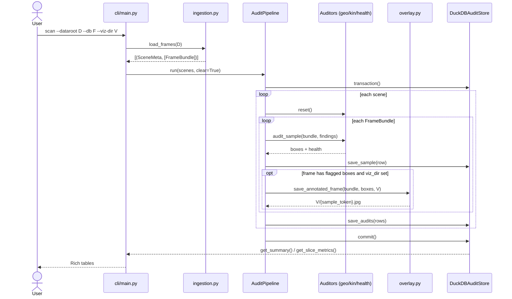
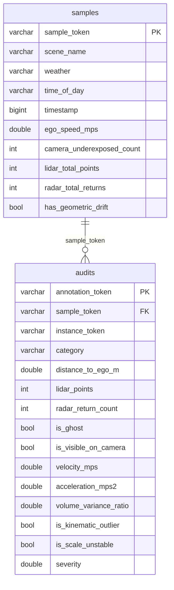

# Architecture

Kozquloq is an annotation linter for autonomous-driving datasets: it ingests
nuScenes keyframes, audits every 3D annotation against the sensor evidence,
and emits invalid-token masks plus annotated overlay images.

## Data contracts

Three frozen dataclasses carry everything between stages
(`src/kozquloq/types.py`). Immutable by rule (see `AGENTS.md`).

- `SceneMeta` - scene token, name, weather, time of day.
- `FrameBundle` - one synchronized keyframe: camera image, lidar points,
  annotation boxes, and the four SE(3) transforms + intrinsics needed for
  the `lidar -> ego -> global -> ego -> camera` reprojection chain.
- `AnnBox` - one 3D annotation in the global frame (nuScenes convention:
  local x = length, y = width, z = height).

## Component overview

## Class diagram

Auditor ordering matters: `GeometricAuditor` fills `findings.boxes`,
`KinematicAuditor` refines them in place (velocity/acceleration need the
per-frame results), `SensorHealthAuditor` reads them for the drift check.

## Sequence: `kozquloq scan`

## Storage schema

Two SQL views sit on top: `view_slice_failure_rates` (failure % grouped by
weather / time of day / category) and `view_severe_outliers`
(`severity >= 0.5` joined with scene context).

## Rules enforced on real data

- **Ghost label**: category is `vehicle.*` or `human.pedestrian.*`, distance
  to ego < 35 m, and zero lidar returns inside the box after ground-plane
  filtering (lidar-frame z < -2.0 m is road surface, never box support).
- **Kinematic outlier**: acceleration exceeds the class cap
  (pedestrian 8, vehicle 12, default 12 m/s^2) between consecutive
  keyframes of one `instance_token`.
- **Scale unstable**: rigid-object volume changes > 15% between frames.
- **Underexposed frame**: mean camera intensity < 25/255.
- **Geometric drift**: a camera-visible box with 20+ lidar hits in 3D shows
  almost no projected returns inside its 2D footprint.
